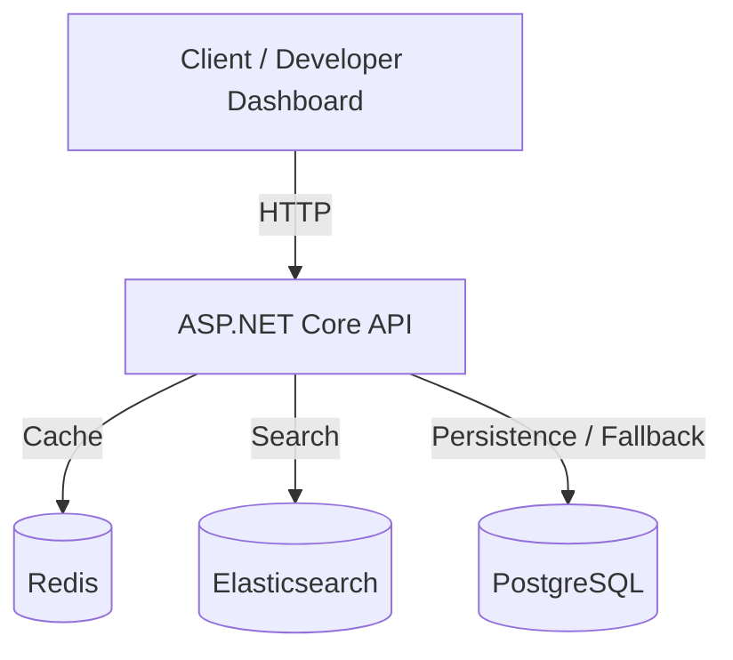

# HighPerformanceCatalogApi

A backend-focused Product Catalog and Search API built with ASP.NET Core 10, PostgreSQL, Redis, Elasticsearch, and Docker.

This project demonstrates backend API development, relational data persistence, cache-aside patterns, search indexing, service resilience, automated testing, and performance benchmarking.

## Features

- RESTful product management endpoints
- PostgreSQL persistence using Entity Framework Core
- Redis caching for product retrieval
- Elasticsearch-based product search
- Redis caching for repeated search queries
- PostgreSQL search fallback when Elasticsearch is unavailable
- Product search-index synchronization
- Infrastructure health checks
- HTTP response-time tracking
- Interactive developer dashboard
- Docker Compose deployment
- Unit and integration tests
- k6 load testing and benchmark documentation

## Technology Stack

| Layer | Technology |
|---|---|
| Language | C# |
| Framework | ASP.NET Core 10 |
| Database | PostgreSQL 18 |
| ORM | Entity Framework Core |
| Cache | Redis 8 |
| Search | Elasticsearch 9.5.4 |
| Containerisation | Docker Compose |
| Testing | xUnit, ASP.NET Core integration testing |
| Performance testing | Grafana k6 |
| Dashboard | HTML, CSS, JavaScript |

## System Architecture

PostgreSQL is the authoritative product data store.

Redis provides temporary caching for frequently requested products and search results.

Elasticsearch maintains a searchable representation of product information.

The API coordinates access to these services and provides a PostgreSQL fallback when Elasticsearch is unavailable.



For detailed request flows, deployment architecture, and design trade-offs, see [Architecture Documentation](docs/architecture.md).

## Getting Started

### Prerequisites

Install:

- Git
- Docker Engine with Docker Compose support
- .NET 10 SDK for running and testing outside Docker

### 1. Clone the Repository

```bash
git clone git@github.com:Evanskarlin/HighPerformanceCatalogApi.git

cd HighPerformanceCatalogApi
```

### 2. Configure Environment Variables

If an example environment file is provided, copy it:

```bash
cp .env.example .env
```

Update the values in `.env` for your local environment.

Do not commit `.env` or real credentials.

### 3. Start the Application

```bash
docker compose up -d --build
```

Check the services:

```bash
docker compose ps
```

The Compose configuration starts the API, PostgreSQL, Redis, and Elasticsearch.

### 4. Access the API

With the current local port mapping:

| Service | URL |
|---|---|
| Developer dashboard | http://localhost:5005 |
| Product endpoints | http://localhost:5005/api/products |
| Search endpoint | http://localhost:5005/api/products/search?q=wireless |
| Health endpoint | http://localhost:5005/health |

## API Endpoints

| Method | Endpoint | Description |
|---|---|---|
| GET | /api/products | Retrieve all products |
| GET | /api/products/{id} | Retrieve a product by ID |
| POST | /api/products | Create a product |
| PUT | /api/products/{id} | Update a product |
| DELETE | /api/products/{id} | Delete a product |
| GET | /api/products/search?q=wireless | Search products |

### Example: Retrieve Products

```bash
curl http://localhost:5005/api/products
```

### Example: Search Products

```bash
curl -i "http://localhost:5005/api/products/search?q=wireless"
```

The search response includes diagnostic headers such as:

- `X-Cache-Status`
- `X-Data-Source`
- `X-Response-Time-Ms`

## Caching Strategy

### Product Retrieval

The API uses the cache-aside pattern:

1. Check Redis for the requested product.
2. Return the cached product if available.
3. Query PostgreSQL on a cache miss.
4. Cache the retrieved product.
5. Return the response.

Product cache entries have an approximately five-minute TTL.

### Search Results

Search requests use:

1. Redis search-result cache.
2. Elasticsearch on a cache miss.
3. PostgreSQL fallback when Elasticsearch is unavailable.

Search-result cache entries have an approximately two-minute TTL.

Search-result caching introduces consistency considerations because cached query results may remain stale until expiration.

## Reliability and Observability

The `/health` endpoint checks PostgreSQL, Redis, and Elasticsearch.

Request-performance middleware measures server-side response time and adds the `X-Response-Time-Ms` response header.

The developer dashboard displays:

- Infrastructure health status
- Product search results
- Response time
- Search cache status
- Search data source

## Automated Testing

Run the test suite:

```bash
dotnet test
```

The project includes unit tests and API integration tests.

The integration tests use in-memory infrastructure implementations, allowing the HTTP pipeline to be tested without starting the full Docker stack.

## Performance Benchmarking

Local benchmarks were conducted using k6 with five peak virtual users and a 40-second ramp-up, steady-state, and ramp-down schedule.

### Results

| Metric | Mixed API Workload | Search-Only Workload |
|---|---:|---:|
| Requests | 156 | 156 |
| Requests/second | 3.88 | 3.89 |
| Average latency | 2.78 ms | 2.54 ms |
| Median latency | 2.62 ms | 2.63 ms |
| P95 latency | 4.39 ms | 3.75 ms |
| Maximum latency | 13.69 ms | 9.41 ms |
| HTTP failure rate | 0% | 0% |

Both workloads passed the configured latency and HTTP failure thresholds.

These results represent a local development benchmark rather than maximum production throughput.

See [Performance Benchmark Results](docs/performance-benchmarks.md) for the environment, methodology, limitations, and analysis.

### Run the Load Test

Start the API and its dependencies first.

Then run:

```bash
docker run --rm \
  --network host \
  -v "$PWD/tests/load:/scripts:ro" \
  -e BASE_URL=http://localhost:5005 \
  grafana/k6:latest \
  run /scripts/catalog-load-test.js
```

To run the search-only workload, add:

```bash
-e SCENARIO=search
```

before the image name.

## Project Structure

```text
HighPerformanceCatalogApi/
├── src/
│   ├── Catalog.Api/
│   ├── Catalog.Application/
│   ├── Catalog.Domain/
│   └── Catalog.Infrastructure/
├── tests/
│   ├── Catalog.UnitTests/
│   ├── Catalog.IntegrationTests/
│   └── load/
├── docs/
│   ├── architecture.md
│   └── performance-benchmarks.md
├── docker-compose.yml
└── README.md
```

## Architecture Trade-offs

This project prioritises learning and demonstrating practical backend engineering patterns.

Current limitations include:

- PostgreSQL and Elasticsearch do not share a distributed transaction.
- Search-index synchronization can fail after database changes.
- Search-query cache invalidation is not yet comprehensive.
- Load tests were conducted at low concurrency on one machine.
- Production security, observability, and scaling require additional work.

Potential improvements include background indexing, the transactional outbox pattern, distributed tracing, authentication, and higher-concurrency benchmarking.

## Project Status

Portfolio and learning project.

The implementation includes core product management, caching, search, infrastructure monitoring, automated testing, and initial performance benchmarks.
