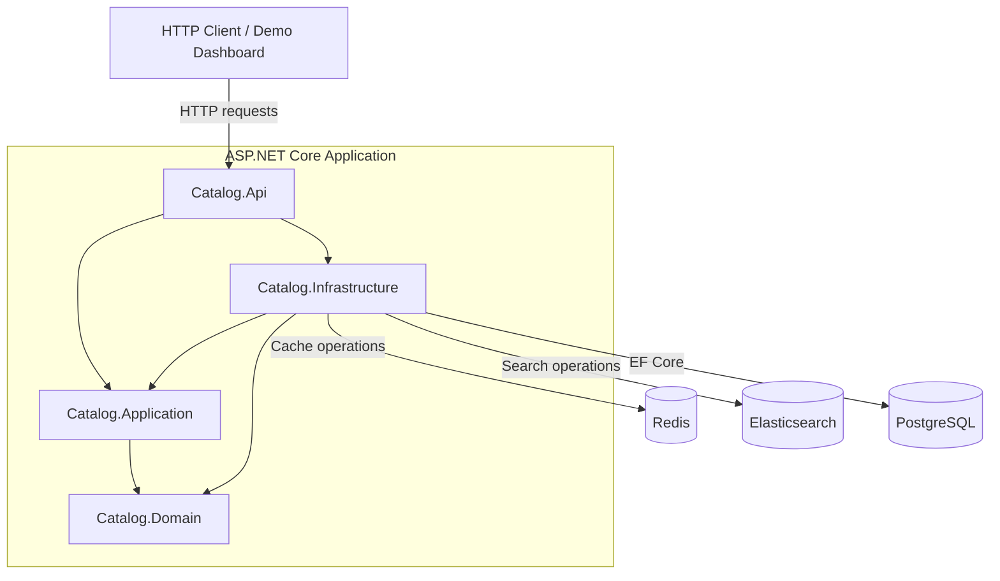
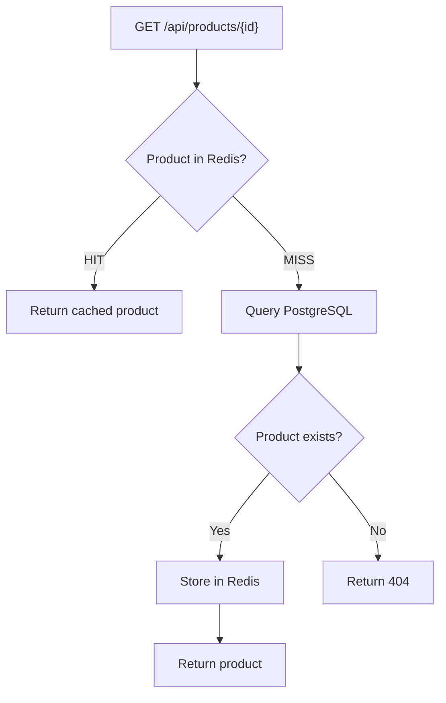
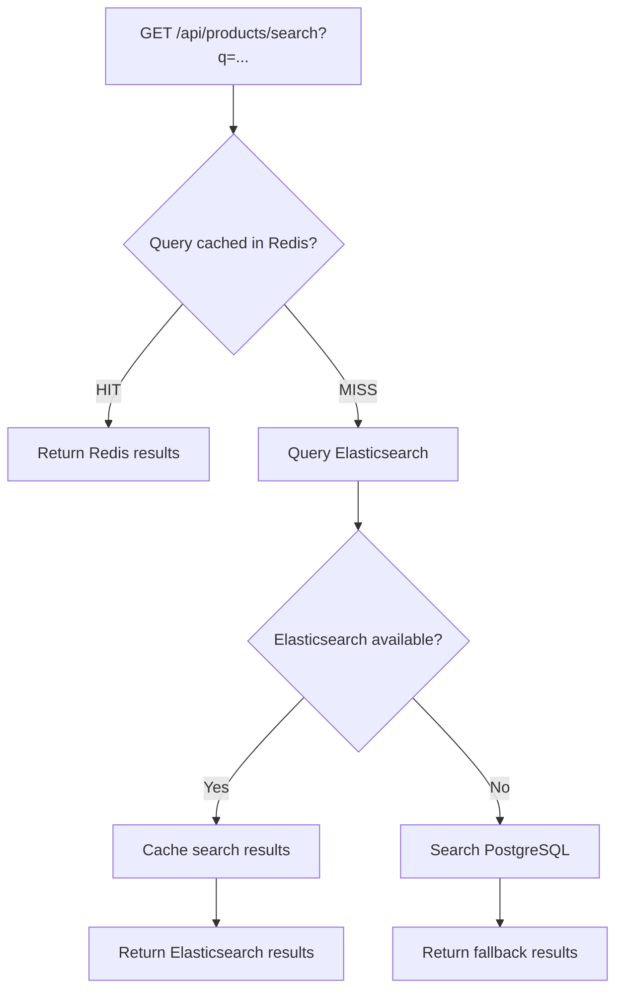
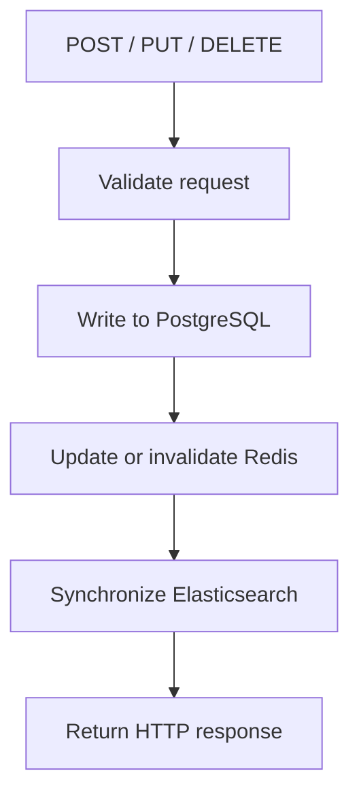
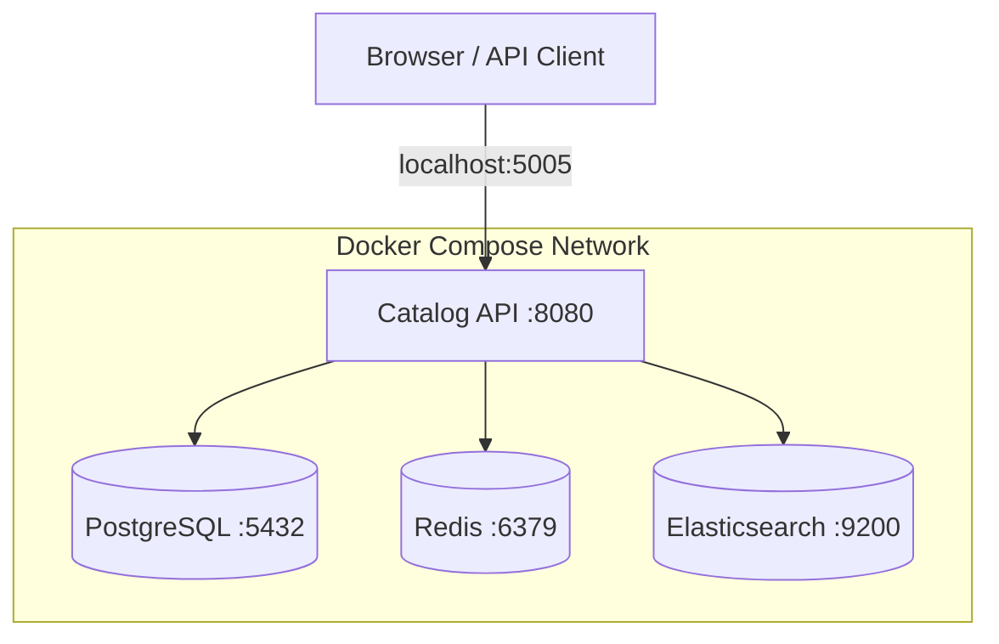

# HighPerformanceCatalogApi — System Architecture

## 1. Overview

HighPerformanceCatalogApi is an ASP.NET Core 10 Product Catalog and Search API built using a layered architecture.

The system integrates:

- PostgreSQL for persistent product storage.
- Redis for caching product and search responses.
- Elasticsearch for full-text product search.
- ASP.NET Core for HTTP endpoints and application orchestration.
- Docker Compose for local infrastructure.
- A lightweight dashboard for health and performance visibility.

PostgreSQL is the source of truth. Redis stores disposable cached responses, while Elasticsearch maintains a searchable representation of product data.

## 2. High-Level Architecture

### Project Responsibilities

| Project | Responsibility |
|---|---|
| Catalog.Api | HTTP controllers, request validation, middleware, health endpoints, dashboard |
| Catalog.Application | Interfaces and application contracts |
| Catalog.Domain | Product domain entity |
| Catalog.Infrastructure | Database repository, caching, Elasticsearch integration |
| Catalog.UnitTests | Domain and request validation tests |
| Catalog.IntegrationTests | API integration tests using in-memory infrastructure |

## 3. Product Retrieval Flow

Product retrieval uses the cache-aside pattern.

The API first checks Redis. If the product is not cached, PostgreSQL is queried.

Retrieved products are cached for approximately five minutes.

## 4. Product Search Flow

Product search combines Redis query caching, Elasticsearch, and PostgreSQL fallback.

Search results are cached for approximately two minutes.

If Elasticsearch becomes unavailable, the API falls back to PostgreSQL.

Fallback results are not added to the Redis search cache.

The PostgreSQL fallback uses a simpler search mechanism and may not provide the same relevance behaviour as Elasticsearch.

## 5. Product Write Operations

PostgreSQL is the authoritative data store.

Product creation, updates, and deletion persist changes to PostgreSQL before performing related cache and search-index operations.

Product-by-ID cache entries are invalidated when products are updated or deleted.

Elasticsearch documents are created, updated, or deleted to reflect product changes.

**Consistency consideration:** PostgreSQL and Elasticsearch do not participate in a single distributed transaction. A failure during search-index synchronization could leave Elasticsearch temporarily inconsistent with PostgreSQL.

A production implementation could improve this through an outbox pattern, background processing, and retry mechanisms.

## 6. Performance and Diagnostics

The API includes request-performance middleware that measures HTTP response times.

The middleware exposes:

`X-Response-Time-Ms`

Search endpoints also expose diagnostic headers:

| Header | Example | Meaning |
|---|---|---|
| X-Response-Time-Ms | 3.25 | Server-side response time in milliseconds |
| X-Cache-Status | HIT | Search response retrieved from cache |
| X-Data-Source | Redis | Data source used for the response |

Possible search data sources include Redis, Elasticsearch, and PostgreSQL.

The developer dashboard displays these diagnostics alongside live search results.

## 7. Infrastructure Health

The `/health` endpoint checks:

- PostgreSQL connectivity.
- Redis availability.
- Elasticsearch availability.

Each dependency has an individual health status.

The dashboard displays these statuses so infrastructure failures can be identified independently.

## 8. Deployment Architecture

The API listens on port 8080 inside its container and is exposed through port 5005 on the development machine.

Docker Compose manages the application and its supporting services.

Local development infrastructure is not configured as a production-hardened deployment.

## 9. Testing Strategy

The project includes:

- Unit tests for domain behaviour and request validation.
- API integration tests using in-memory implementations.
- k6 load tests for mixed API traffic and repeated search requests.

The integration tests exercise the HTTP pipeline without requiring the full Docker infrastructure stack.

The k6 benchmarks exercise the running application and its real supporting services.

## 10. Design Trade-offs

### Redis

Redis reduces repeated reads but introduces cache invalidation and consistency considerations.

### Elasticsearch

Elasticsearch provides dedicated search capabilities but introduces index synchronization and operational complexity.

### PostgreSQL Fallback

PostgreSQL fallback improves availability when Elasticsearch fails, although search semantics and performance may differ.

### Docker Compose

Docker Compose provides a reproducible local environment but is not equivalent to a production orchestration platform.

### Observability

Response-time headers and health checks provide basic operational visibility. Future improvements could include distributed tracing, structured telemetry, and time-series metrics.

## 11. Future Improvements

Potential improvements include:

- Reliable search-index synchronization using an outbox pattern.
- Search-cache invalidation after product mutations.
- Background indexing and retry mechanisms.
- Distributed tracing.
- Prometheus metrics and Grafana dashboards.
- Higher-concurrency load tests.
- Authentication, authorization, and API rate limiting.
- Production deployment and secret management.
